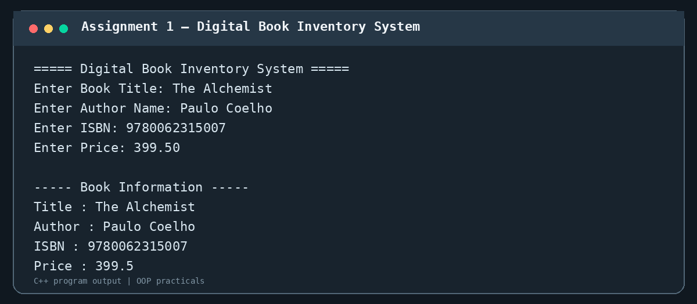

# Assignment 01

**Topic:** Book class — digital inventory system

Source and output available.

- Source: [`Assignment_01.cpp`](Assignment_01.cpp)

## Output

---

[Back to the repository assignment index](../README.md)
