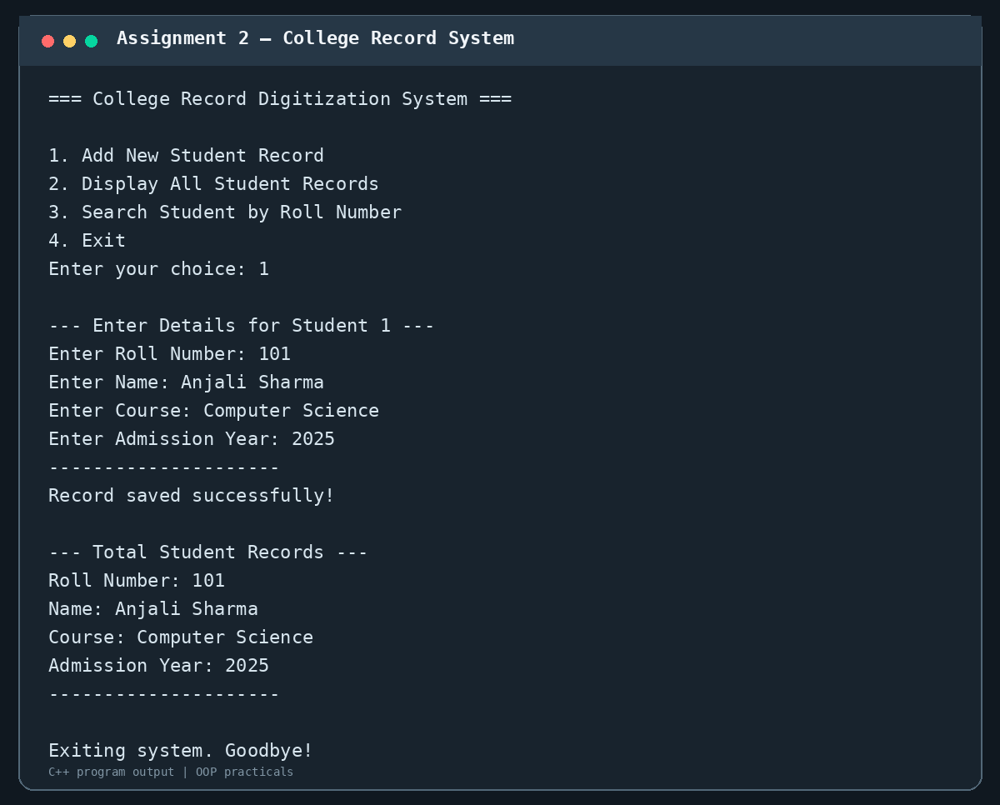

# Assignment 02

**Topic:** Student class — college records system

Source and output available.

- Source: [`Assignment_02.cpp`](Assignment_02.cpp)

## Output

---

[Back to the repository assignment index](../README.md)
