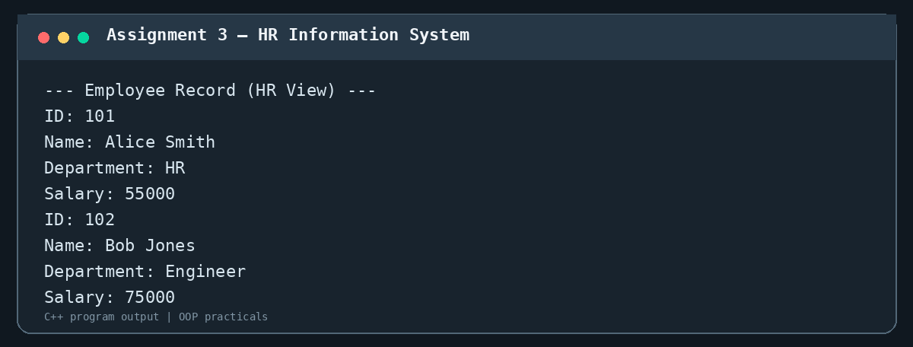

# Assignment 03

**Topic:** Employee class — HR information system

Source and output available.

- Source: [`Assignment_03.cpp`](Assignment_03.cpp)

## Output

---

[Back to the repository assignment index](../README.md)
