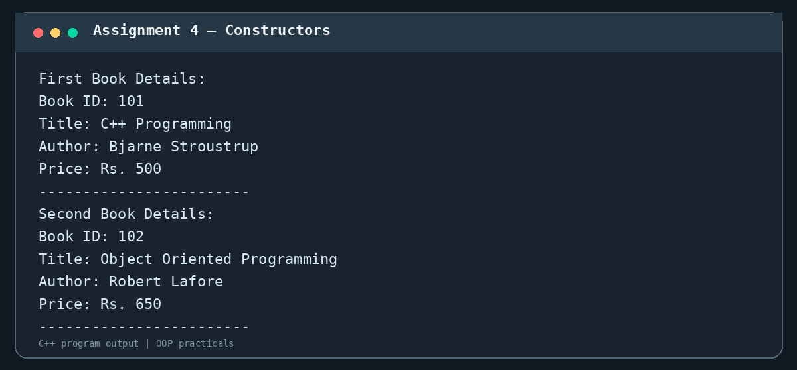

# Assignment 04

**Topic:** Book class — default and parameterized constructors

Source and output available.

- Source: [`Assignment_04.cpp`](Assignment_04.cpp)

## Output

---

[Back to the repository assignment index](../README.md)
