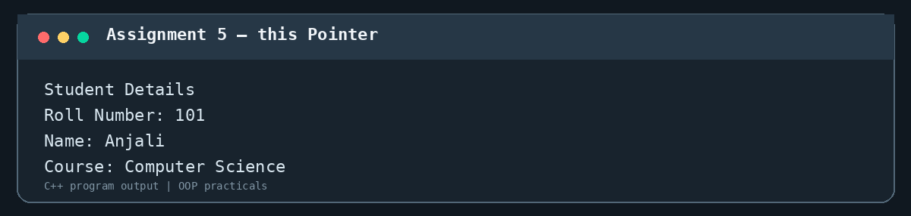

# Assignment 05

**Topic:** Student class — the this pointer for same-name parameters

Source and output available.

- Source: [`Assignment_05.cpp`](Assignment_05.cpp)

## Output

---

[Back to the repository assignment index](../README.md)
