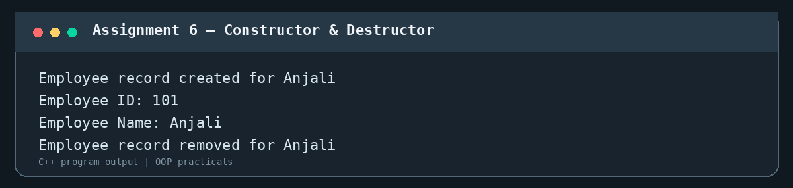

# Assignment 06

**Topic:** Employee class — constructor and destructor messages

Source and output available.

- Source: [`Assignment_06.cpp`](Assignment_06.cpp)
- Interactive version: [`Assignment_06_interactive.cpp`](Assignment_06_interactive.cpp)

## Output

---

[Back to the repository assignment index](../README.md)
