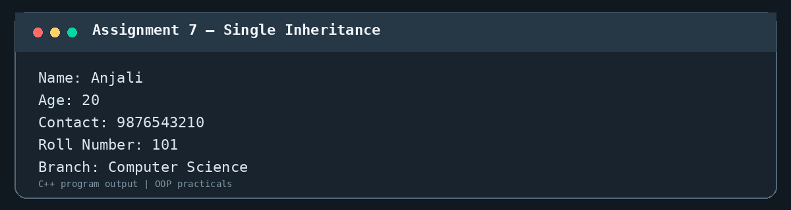

# Assignment 07

**Topic:** Person/Student — single inheritance without data duplication

Source and output available.

- Source: [`Assignment_07.cpp`](Assignment_07.cpp)
- Interactive version: [`Assignment_07_interactive.cpp`](Assignment_07_interactive.cpp)

## Output

---

[Back to the repository assignment index](../README.md)
