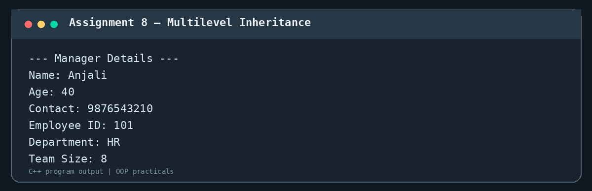

# Assignment 08

**Topic:** Person → Employee → Manager — multilevel inheritance

Source and output available.

- Source: [`Assignment_08.cpp`](Assignment_08.cpp)
- Interactive version: [`Assignment_08_interactive.cpp`](Assignment_08_interactive.cpp)

## Output

---

[Back to the repository assignment index](../README.md)
