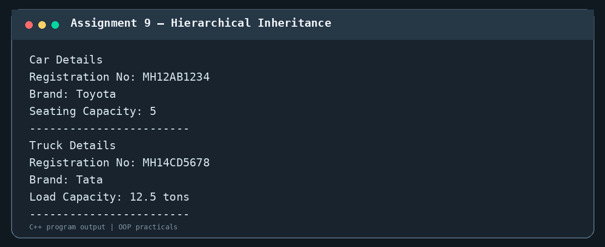

# Assignment 09

**Topic:** Vehicle management — hierarchical inheritance

Source and output available.

- Source: [`Assignment_09.cpp`](Assignment_09.cpp)
- Interactive version: [`Assignment_09_interactive.cpp`](Assignment_09_interactive.cpp)

## Output

---

[Back to the repository assignment index](../README.md)
