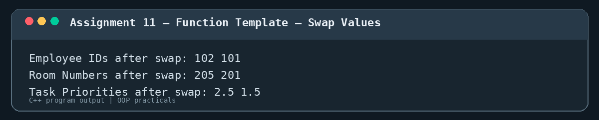

# Assignment 11

**Topic:** Generic swap() function template

Source and output available.

- Source: [`Assignment_11.cpp`](Assignment_11.cpp)

## Output

---

[Back to the repository assignment index](../README.md)
