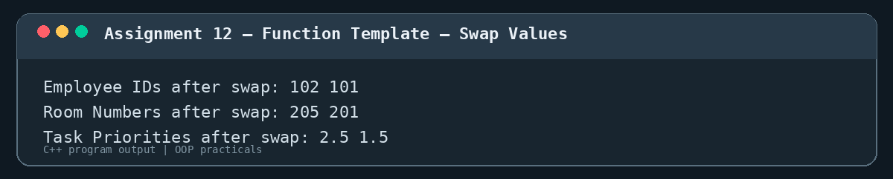

# Assignment 12

**Topic:** Generic storage class template

Source and output available.

- Source: [`Assignment_12.cpp`](Assignment_12.cpp)

## Output

---

[Back to the repository assignment index](../README.md)
