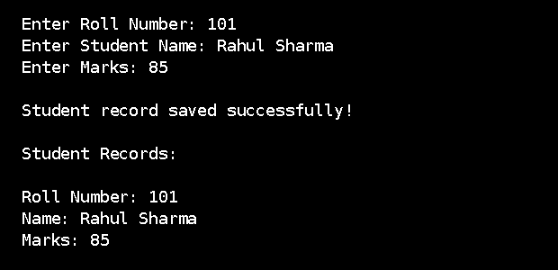

# Assignment 13

**Topic:** Student records — permanent file storage and retrieval

Source and output available.

- Source: [`Assignment_13.cpp`](Assignment_13.cpp)

## Output

---

[Back to the repository assignment index](../README.md)
